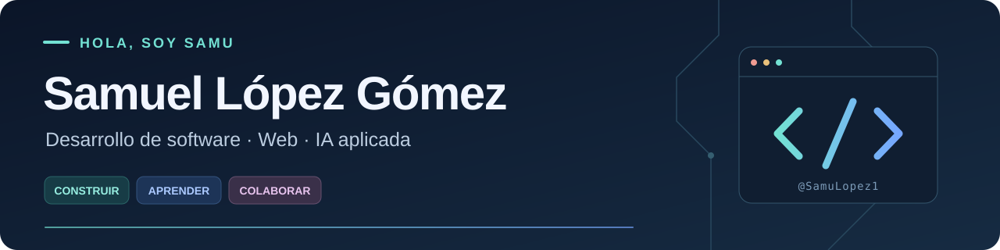

  

  <strong>Ingeniería de Sistemas en EAFIT · Medellín, Colombia</strong> 
  Me gusta transformar ideas y problemas concretos en aplicaciones que se puedan usar.

## 👋 Un poco sobre mí

- 🎓 Soy **Samuel López Gómez**, aunque también puedes llamarme **Samu**. Estudio Ingeniería de Sistemas en la Universidad EAFIT.
- 💻 Me interesa el **desarrollo de software**, desde la interfaz y las APIs hasta las bases de datos y las pruebas.
- 🧠 Exploro la **inteligencia artificial aplicada**, la evaluación de modelos y el análisis facial con visión por computador.
- 🚀 Participo en **Zolutio**, un emprendimiento tecnológico en formación con compañeros, donde colaboro en requerimientos, arquitectura y desarrollo.
- 🌱 Aprendo construyendo proyectos, revisando código y probando nuevas herramientas. También uso asistentes de IA para apoyar ese proceso.

## 🛠️ Tecnologías con las que trabajo

**Lenguajes**

  
  
  
  
  

**Web y backend**

  
  
  
  
  

**Datos y herramientas**

  
  
  
  
  

## ✨ Algunas cosas que he construido

| Proyecto | Qué encontrarás | Enlace |
| --- | --- | --- |
| 🎟️ **Qvent** | Plataforma de eventos con compra simulada, entradas QR, autenticación y pruebas. **Next.js · TypeScript · Prisma · PostgreSQL** | [Ver demo](https://proyecto-web-tawny-mu.vercel.app/) |
| 🧠 **Asistente jurídico laboral** | Proyecto académico de cuatro integrantes. Mi aporte: pipeline de evaluación, casos de prueba, reporte de resultados y ejecución en Colab. **Python · BETO · LoRA** | [Ver código del equipo](https://github.com/Bosnape/cabrejos-ortiz-valencia-lopez) |
| 👁️ **Iglu** | Prototipo de monitoreo de fatiga facial en el navegador, con análisis local y alertas. **React · TypeScript · MediaPipe** | [Ver código](https://github.com/SamuLopez1/Iglu) |
| 📦 **Invendex** | MVP para inventario, ventas y cierre diario. **Next.js · TypeScript · Supabase** | [Ver código](https://github.com/SamuLopez1/Invendex) |
| 🦷 **DentalExpertos** | Sitio responsivo para presentar los servicios de una clínica y facilitar el contacto. **TypeScript · Node.js** | [Ver sitio](https://dentalexpertos.com/inicio) |

## 🔭 En qué quiero seguir creciendo

**Desarrollo web · Backend y APIs · IA aplicada · Pruebas y calidad de software**

Me interesa entender cómo funciona lo que construyo, mejorar con cada proyecto y trabajar con otras personas para resolver problemas.

---

  <a href="https://github.com/SamuLopez1?tab=repositories"><strong>Explora mis repositorios ↗</strong></a>

